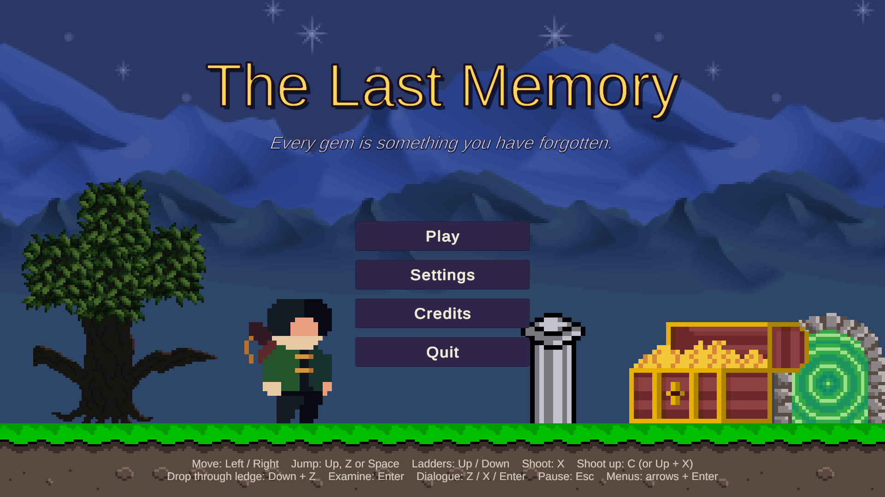

# The Last Memory

A short 2D pixel-art platformer about a hero who keeps choosing to forget.

You wake up in a forest with no memory. A note on an old tree says *"This time, don't open the chest."*
Seven notches are carved into the bark. Cross the forest and an abandoned castle, collect the gems that turn out
to be pieces of your own past, and face the Keeper, the dragon that guards the chest, to find out what you gave up,
and why.

Made with **Unity 6 (6000.2.13f1)** and **C#** as a university project: URP 2D with 2D lights, Tilemaps, the
Input System and TextMesh Pro.

## Features
- Three levels: The Whispering Forest, The Abandoned Castle, and the Treasure Chamber.
- Running, variable-height jumping, ladders, one-way ledges, and shooting forward and upward.
- Six kinds of enemies and hazards (spikes, slime, spider, skeleton, shooting ghost, bat) and a three-attack boss.
- A story told through notes, a ghost, memory shards and an ending flashback, with a cyclical ending.
  Every finished game adds a notch to the tree, and the count is saved.
- Music, 24 sound effects, a main menu, settings, pause, keyboard and gamepad support.
- Levels built from ASCII layouts by an editor tool; 60 automated Play Mode tests.

## Controls
| Action | Keyboard | Gamepad |
|---|---|---|
| Move | ← / → | Left stick / D-pad |
| Jump | ↑, Z or Space | South |
| Climb | ↑ / ↓ at a ladder | Stick |
| Shoot / shoot up | X / **C** (or ↑ + X) | West / right shoulder |
| Drop through a ledge | ↓ + Z | Down + South |
| Examine | Enter | North |
| Dialogue | Z / X / C / Space / Enter | South / East / West |
| Pause | Esc | Start |

## Running the project
1. Open the folder in Unity Hub with Unity **6000.2.13f1** (Git must be installed: one package is fetched from Git).
2. Open `Assets/_Game/Scenes/MainMenu.unity` and press Play.
3. Tests: Window → General → Test Runner → PlayMode → Run All.
4. Windows build: **Tools → The Last Memory → Build Windows Player** → `Builds/TheLastMemory_Windows/The Last Memory.exe`.

The scenes and prefabs are generated from the level layouts by **Tools → The Last Memory → Rebuild Game**.

## Documentation
| Document | Contents |
|---|---|
| [Docs/STUDENT_PROJECT_GUIDE.md](Docs/STUDENT_PROJECT_GUIDE.md) | How the game and the code work; how to present it; assignment requirements |
| [Docs/GAME_DESIGN.md](Docs/GAME_DESIGN.md) | Mechanics, levels, enemies, boss, numbers, technical structure |
| [Docs/STORY_SPEC.md](Docs/STORY_SPEC.md) | The full story and every line of dialogue |
| [Docs/QA_CHECKLIST.md](Docs/QA_CHECKLIST.md) | Manual test plan |
| [Docs/DEVELOPMENT_PROGRESS.md](Docs/DEVELOPMENT_PROGRESS.md) | What was changed in each iteration, and how it was verified |
| [Docs/ASSET_CREDITS.md](Docs/ASSET_CREDITS.md) | Third-party art and audio, licences and attribution |
| [Tools/LevelTools/README.md](Tools/LevelTools/README.md) | Python scripts for creating and checking level layouts |

## Credits
Art and audio by STAEL, Glax, Rotting Pixels, 7Soul1, Yevhen Babiichuk (DustDFG, CC BY 4.0), HydroGene,
Memoraphile and Kenney, and the authors of the OpenGameArt castle, enemy and portal packs. Full details and
licences: [Docs/ASSET_CREDITS.md](Docs/ASSET_CREDITS.md). The story, levels, code and the remaining pixel art were
made for this project.

The project began as the "TileVania" exercise of a Unity course and was rebuilt from it; that is why the
repository and folder still carry the old name.
